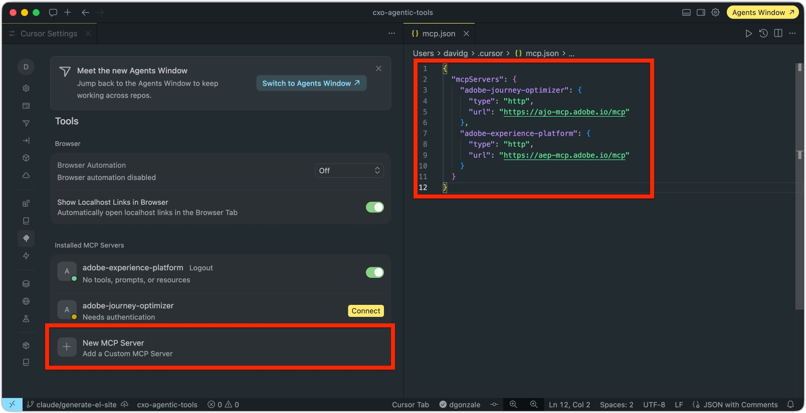
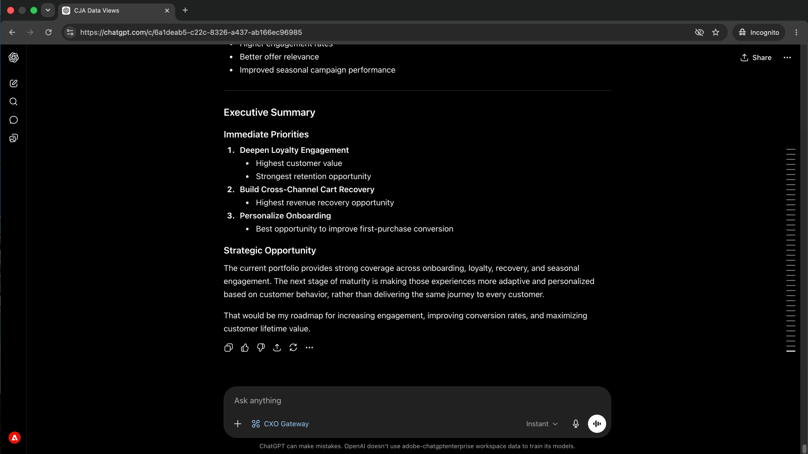
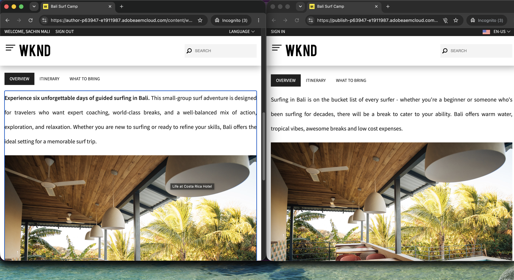

# MCP-Server

<!-- last-modified: 2026-09-16 -->

Adobe MCP-Server bieten jeder kompatiblen KI-Plattform direkten, gesteuerten Zugriff auf Adobe-Daten und -Workflows. Wenn Sie einmal eine Verbindung herstellen, können Sie die Kampagnenleistung abfragen, Zielgruppen aktivieren, Journey überprüfen, Inhalte verwalten und vieles mehr - alles in einfacher Sprache, ohne Ihre KI-Umgebung verlassen zu müssen. Da sich MCP-Server zwischen Ihrer KI-Plattform und den zugrunde liegenden Systemen von Adobe befinden, erhalten Sie Flexibilität in natürlicher Sprache, während die Zugriffskontrollen und die Data Governance in Ihrem Unternehmen weiterhin gelten.

Adobe MCP-Server folgen dem Open [Model Context Protocol](https://modelcontextprotocol.io/docs/getting-started/intro)-Standard. Jede MCP-kompatible KI-Plattform stellt eine Verbindung zu jedem Adobe MCP-Server her.

>[!TIP]
>
>**Beginnen Sie mit Adobe CX Enterprise Coworker für KI-Plattformen.** Dies ist die beste Möglichkeit, Adobe MCP mit Ihrer KI-Plattform zu verwenden. Fügen Sie Claude, ChatGPT, Microsoft 365 Copilot, Gemini Enterprise und mehr einen MCP-Server hinzu und arbeiten Sie von dort aus mit Adobe CX Enterprise Coworker.
>
>* **Eine Verbindung, nicht viele.** Sie richten einen MCP-Server ein, anstatt jede Adobe-Anwendung separat zu verbinden.
>* **Ihr Zugriff, übernommen.** Sie melden sich mit Ihren Adobe-Anmeldeinformationen an, und Coworker verwendet den Zugriff, den Sie bereits haben. Es sind keine separaten Berechtigungen eingerichtet.
>* **Sicher und designorientiert.** Coworker ermöglicht jedem Benutzer kontrollierten Zugriff auf die dahinter liegenden CX Enterprise-Anwendungen. Einige Benutzende haben nur Lesezugriff auf bestimmte Inhalte oder Daten, andere haben Lese- und Schreibzugriff, je nachdem, wie ihre Benutzenden konfiguriert sind und welcher Zugriff ihnen gewährt wurde. [Erfahren Sie mehr über die Zugriffssteuerung in Coworker](https://experienceleague.adobe.com/de/docs/coworker/content/administration/access-control).
>
>Sie arbeiten bereits in anderen KI-Plattformen und haben Workflows um sie herum erstellt? Sie können auch von diesen Plattformen aus auf die Funktionen von Mitarbeitern zugreifen, ohne die Funktionsweise zu ändern. [Einrichten von Coworker für KI-Plattformen](#connect-to-your-ai-platform)
>
>Wenn dies für Sie keine Option ist, können Sie auch [Ihre KI-Plattform direkt mit den MCP-Servern des Produkts verbinden](#connect-to-your-ai-platform).

## CX Enterprise-MCP-Server {#cx-enterprise-mcp-servers}

>[!CONTEXTUALHELP]
>id="cx-enterprise-agentic-tools_mcp_servers_cx-enterprise"
>title="Coworker"
>abstract="Fragen, analysieren und ergreifen Sie Maßnahmen in Ihren CX Enterprise-Anwendungen – in einfacher Sprache und ohne Server-Einrichtung. Bei einzelnen Anwendungen mit einem eigenen MCP-Server stellen Sie stattdessen eine direkte Verbindung her."
>additional-url="https://experienceleague.adobe.com/de/docs/cx-enterprise-coworker/content/home" text="Coworker-Dokumentation"


Es gibt drei Möglichkeiten, mit Ihren CX Enterprise-Programmen über KI zu arbeiten. Erkunden Sie sie in dieser Reihenfolge:

1. **Mitarbeiter.** Der schnellste Weg, um Ihre CX Enterprise-Programme zu bearbeiten. Es ist mit ihnen kompatibel, ohne Server-Setup, ohne zu registrierenden Endpunkt und ohne KI-Plattformkonfiguration. [Teamkollege versuchen](https://experienceleague.adobe.com/de/docs/cx-enterprise-coworker/content/home)
2. **Mitarbeiter für KI-Plattformen.** Wenn Sie Coworker nicht direkt verwenden können oder möchten, verwenden Sie es von Ihrer eigenen KI-Plattform, wie Microsoft 365 Copilot, ChatGPT oder Claude. [Einrichten von Coworker für KI-Plattformen](#connect-to-your-ai-platform)
3. **Produkt-MCP-Server.** Wenn keine der Optionen für Sie funktioniert, verbinden Sie Ihre KI-Plattform direkt mit dem MCP-Server für eine bestimmte Adobe-Anwendung. [Verbindung zu einem MCP-Server herstellen](#connect-to-your-ai-platform)

Mehrere Anwendungen verfügen über einen eigenen MCP-Server.

| MCP-Server | Endpunkt | Mögliche Optionen | Auch über einen Kollegen |
| --- | --- | --- | --- |
| [Adobe Journey Optimizer](https://experienceleague.adobe.com/de/docs/experience-cloud-ai/experience-cloud-ai/mcp/mcp-product-tools/ajo-mcp) | `https://ajo-mcp.adobe.io/mcp` | Überprüfen von Journey-, Kampagnen- und Kanalkonfigurationen | Ja |
| [Customer Journey Analytics](https://experienceleague.adobe.com/de/docs/experience-cloud-ai/experience-cloud-ai/mcp/mcp-product-tools/cja-mcp) | `https://cja-mcp.adobe.io/mcp` | Berichte abfragen, Datenansichten ermitteln und Arbeitsbereiche erstellen | Ja |
| [Adobe Analytics](https://experienceleague.adobe.com/de/docs/experience-cloud-ai/experience-cloud-ai/mcp/mcp-product-tools/analytics-mcp) | `https://aa-mcp.adobe.io/mcp` | Erkennung von Report Suites, Segmenterstellung und Workspace-Erstellung | Ja |
| [Adobe Target](https://experienceleague.adobe.com/de/docs/target/using/mcp/target-mcp) | `https://targetmcp.adobe.io/mcp` | Überprüfen von Aktivitäten, Angeboten, Zielgruppen, Mboxes, Leistungsberichten und Vorschau-URLs (öffentliche Beta-Tools sind schreibgeschützt, Schreib-Tools sind für die allgemeine Verfügbarkeit geplant) | Ja |
| [Real-Time CDP](https://experienceleague.adobe.com/de/docs/experience-platform/rtcdp/intro/rtcdp-mcp) | `https://rtcdp-mcp.adobe.io/mcp` | Suchen Sie nach Zielgruppen, Zielen, Quellen und Flussausführungen; überprüfen Sie Identitäts-Namespaces und Zusammenführungsrichtlinien (öffentliche Beta-Zulassungsliste erforderlich, alle Tools sind schreibgeschützt) | Ja |
| [AEM MCP-Server](https://experienceleague.adobe.com/de/docs/experience-manager-learn/cloud-service/ai/mcp-servers/overview) | `https://mcp.adobeaemcloud.com/adobe/mcp/aem` | Seiten, Inhaltsfragmente, Assets und Launches verwalten und Inhalte und Bilder anhand von Markenrichtlinien und Compliance-Regeln bewerten | Ja |
| [AEM Cloud Manager](https://experienceleague.adobe.com/de/docs/experience-manager-learn/cloud-service/ai/mcp-servers/cloud-manager) | `https://mcp.adobeaemcloud.com/adobe/mcp/cloudmanager` | Programme, Umgebungen, Pipelines und Repositorys verwalten | Nein |
| Adobe Marketing Agent | `https://aep-ai-ama.adobe.io/mcp` | Orchestrieren von Zielgruppenanalysen, AEP-Diagnosen und AJO B2B-Journey-Erstellung in allen AEP-Anwendungen | Nein |
| [Adobe Workfront](https://experienceleague.adobe.com/de/docs/workfront/using/basics/workfront-mcp-server/workfront-mcp-server-overview) | `https://mcp.prod.us-west-2.aws.wfk8s.com/mcp/v1/workfront` | Arbeiten, Projekte, Planungsdatensätze, Einblicke und Inhaltsgenehmigungen verwalten | Nein |
| [Marketo Engage](https://experienceleague.adobe.com/de/docs/marketo-developer/marketo/mcp-server) | `https://marketo-mcp.adobe.io/mcp` | Verwalten von Formularen, intelligenten Kampagnen, Leads, Listen, Programmen, E-Mails und Massenvorgängen | Ja |
| Adobe Experience Platform | Über [Mitarbeiter](https://experienceleague.adobe.com/de/docs/cx-enterprise-coworker/content/home) | Datensatz-Erkennung, Schema-Browsing und Sandbox-Management | K. A. |
| Campaign Classic | Über [Mitarbeiter](https://experienceleague.adobe.com/de/docs/cx-enterprise-coworker/content/home) | Erkennung der Campaign-Instanz, Schemabrowser, Abfrageausführung, Workflow-Kontrolle und SOAP/JS-Ausführung | K. A. |
| Experimentieren | Über [Mitarbeiter](https://experienceleague.adobe.com/de/docs/cx-enterprise-coworker/content/home) | A/B-, MVT- und MAB-Experimentberichte, Metriken, Einblicke, Opportunities und Planung des Stichprobenumfangs | K. A. |
| GenStudio for Performance Marketing | Über [Mitarbeiter](https://experienceleague.adobe.com/de/docs/cx-enterprise-coworker/content/home) | Zugriff auf Daten zur Anzeigenleistung und kreative Einblicke | K. A. |
| Adobe Journey Optimizer B2B Edition | Über [Mitarbeiter](https://experienceleague.adobe.com/de/docs/cx-enterprise-coworker/content/home) | Verwalten von B2B-Journey, Account-Programmen, Einkaufsgruppen und Personalisierung | K. A. |

>[!NOTE]
>
>Der Zugriff auf jeden MCP-Server hängt von den Berechtigungen Ihres Unternehmens für dieses Programm und den Benutzerberechtigungen darin ab. Für die letzten fünf Zeilen ist noch kein eigener MCP-Server für die direkte Verbindung verfügbar. Benutze Coworker, um sie heute zu erreichen.

## Herstellen einer Verbindung zu Ihrer KI-Plattform {#connect-to-your-ai-platform}

Die meisten Adobe MCP-Server verwenden OAuth mit Adobe Identity Management Service (IMS). Wählen Sie bei Aufforderung die richtige IMS-Organisation aus. Die Wahl des falschen ist die häufigste Ursache für Authentifizierungsfehler.


Wenn Sie Coworker direkt verwenden, gilt für Sie nichts weiter unten. Um Coworker aus Ihrer eigenen KI-Plattform zu verwenden, beginnen Sie mit der Registerkarte **Coworker for AI**&quot;. Die restlichen Registerkarten dienen zum direkten Verbinden Ihrer eigenen KI-Plattform mit einem Adobe MCP-Server und verwenden den Endpunkt AEM MCP Server als Beispiel. Derselbe Prozess gilt für jeden Adobe MCP-Server: Tauschen Sie die Endpunkt-URL gegen den Server aus, zu dem Sie eine Verbindung herstellen möchten.

>[!BEGINTABS]

>[!TAB Coworker]

Coworker verfügt bereits über viele dieser MCP-Funktionen. Es gibt keinen hinzuzufügenden Server, keinen zu registrierenden Endpunkt und keine zu konfigurierende KI-Plattform. Melden Sie sich bei Coworker an, und es ist einsatzbereit.

Vollständige Dokumentation: [Coworker documentation](https://experienceleague.adobe.com/de/docs/cx-enterprise-coworker/content/home)

>[!TAB Mitarbeiter für KI-Plattformen]

Coworker for AI-Plattformen ist ein MCP-Server, der Ihre KI-Plattform mit Coworker verbindet. Alles, was in Coworker verfügbar ist, ist damit verfügbar. Sie verwenden Ihre KI-Plattform wie Claude, ChatGPT, Microsoft 365 Copilot oder Gemini Enterprise als Chat-Oberfläche und Coworker erledigt die Arbeit im Hintergrund, genauso wie wenn Sie Coworker direkt verwenden.

>[!VIDEO](https://video.tv.adobe.com/v/3508455/?learn=on&enablevpops)

Sie melden sich mit Ihren Adobe-Anmeldeinformationen an und Coworker verwendet den Zugriff, der mit Ihrer Adobe-Identität verknüpft ist. Mitarbeiter sind sicher und unterliegen Design. Was Sie lesen oder ändern können, hängt davon ab, wie Ihre Benutzerin bzw. Ihr Benutzer konfiguriert ist, welcher Zugriff Ihnen in Coworker gewährt wird und welcher Zugriff in den Anwendungen gewährt wird, die Coworker in Ihrem Namen verwendet. Siehe [Zugriffssteuerung für Kollegen](https://experienceleague.adobe.com/de/docs/coworker/content/administration/access-control).

Bevor Sie beginnen, stellen Sie Folgendes sicher:

* Ein Mitarbeiter wurde für Ihr Unternehmen bereitgestellt und Sie haben in Adobe Zugriff darauf.
* Ihr Unternehmen verfügt über Adobe Experience Platform und mindestens eines der Programme Adobe Real-Time CDP, Adobe Journey Optimizer oder Adobe Customer Journey Analytics.
* Sie haben Zugriff auf eine unterstützte KI-Plattform.

Der Server-Endpunkt ist `https://mcp.coworker.experience.adobe.io`. Die Einrichtung unterscheidet sich je nach KI-Plattform und beginnt in der Regel damit, dass ein Administrator Adobe CX Enterprise Coworker für Ihr Unternehmen genehmigt. [Einrichten von Coworker für KI-Plattformen](https://experienceleague.adobe.com/de/docs/coworker/content/ai-platforms#set-up-coworker)

>[!TAB Claude.ai]

###  Verwenden eines verwalteten Connectors

Wechseln Sie zur [Adobe AI-](https://developer.adobe.com/ai-registry/?type=connector) und suchen Sie nach Ihrer Adobe-Anwendung. Wenn ein Claude-Connector aufgeführt ist (z. B. der [Adobe Experience Manager-Connector](https://developer.adobe.com/ai-registry/#/connectors/adobe-experience-manager-connector)), befolgen Sie dessen Einrichtungsanweisungen anstelle der folgenden Schritte.

### Verbinden über einen benutzerdefinierten Connector

Claude.ai unterstützt Remote-MCP-Server über benutzerdefinierte Connectoren in den Kontoeinstellungen.

1. Navigieren Sie **Einstellungen > Integrationen**.
2. Klicken Sie **Benutzerdefinierten Connector hinzufügen**.
3. Geben Sie den Server-Endpunkt als URL (z. B. `https://mcp.adobeaemcloud.com/adobe/mcp/aem` für den AEM MCP-Server) und einen Anzeigenamen Ihrer Wahl ein.
4. Klicken Sie auf **Verbinden** und melden Sie sich mit Ihrer Adobe ID an. Wählen Sie die richtige IMS-Organisation aus.

Vollständiges Setup: [Claude.ai Custom Connectors-Dokumentation](https://support.claude.com/en/articles/11175166-get-started-with-custom-connectors-using-remote-mcp)

>[!TAB Claude Code]

### Verwenden der CLI

Führen Sie `claude mcp add` aus, um einen Adobe MCP-Server zu registrieren. Ersetzen Sie den Servernamen und die URL durch die Werte für den Server, zu dem Sie eine Verbindung herstellen möchten. In diesem Beispiel wird der AEM MCP-Server verwendet:

```bash
claude mcp add --transport http adobe-aem https://mcp.adobeaemcloud.com/adobe/mcp/aem
```

### Bearbeiten der Einstellungsdatei

Fügen Sie den Server zu `~/.claude.json` (global) oder `.mcp.json` in Ihrem Projektstamm (Projektebene) hinzu. Ersetzen Sie den Schlüssel und die URL durch die Werte für den Server, den Sie verbinden möchten:

```json
{
  "mcpServers": {
    "adobe-aem": {
      "type": "http",
      "url": "https://mcp.adobeaemcloud.com/adobe/mcp/aem"
    }
  }
}
```

Adobe MCP-Server verwenden OAuth. Claude Code fordert Sie auf, sich beim ersten Aufruf eines Tools bei Ihrer Adobe ID zu authentifizieren. Wählen Sie bei Aufforderung die richtige IMS-Organisation aus.

Vollständiges Setup: [Claude Code MCP-Dokumentation](https://docs.anthropic.com/en/docs/claude-code/mcp)

>[!TAB Cursor]

Fügen Sie einen Adobe MCP-Server zu Ihrer Cursor `mcp.json`-Konfigurationsdatei hinzu und stellen Sie dann eine Verbindung über **Einstellungen > MCP** her. Ersetzen Sie den Schlüssel und die URL durch die Werte für den Server, zu dem Sie eine Verbindung herstellen möchten. In diesem Beispiel wird der AEM MCP-Server verwendet:

- **Global (alle Projekte):** `~/.cursor/mcp.json`
- **Projektebene:** `.cursor/mcp.json` im Projektstamm

```json
{
  "mcpServers": {
    "adobe-aem": {
      "type": "http",
      "url": "https://mcp.adobeaemcloud.com/adobe/mcp/aem"
    }
  }
}
```

Nach dem Hinzufügen werden MCP-Server unter **Installierte MCP-Server** in den Cursor-Einstellungen angezeigt. Wählen Sie **Verbinden** neben einem Server aus, der **Authentifizierung** erfordert) anzeigt, und melden Sie sich mit Ihrer Adobe ID an. Wählen Sie die IMS-Organisation aus, die Zugriff auf das Programm hat.



Vollständiges Setup: [Cursor-MCP-Dokumentation](https://cursor.com/docs/mcp)

>[!TAB ChatGPT]

###  Verwenden eines verwalteten Connectors

Wechseln Sie zur [Adobe AI-](https://developer.adobe.com/ai-registry/?type=connector) und suchen Sie nach Ihrer Adobe-Anwendung. Wenn ein ChatGPT-Connector aufgeführt wird, befolgen Sie die Setup-Anweisungen anstelle der folgenden Schritte.

### Verbindung über Remote-MCP-Server herstellen

Bitten Sie Ihren ChatGPT-Administrator, den MCP-Server für Ihre Organisation hinzuzufügen. Auf diese Weise kann jeder Benutzer eine Verbindung herstellen, ohne die unten stehende Einrichtung zu verwenden.

Wenn ein Administrator diese nicht hinzufügen kann oder Sie die Verbindung nur für Ihr Konto herstellen möchten, führen Sie die folgenden Schritte aus.

**Einmaliges Setup:** Aktivieren Sie den Entwicklermodus, bevor Sie eine benutzerdefinierte MCP-URL registrieren können.

1. Navigieren Sie **Einstellungen > Sicherheit und Anmeldung**.
2. Aktivieren Sie **Entwicklermodus**.

**Server hinzufügen:**

1. Navigieren Sie **Einstellungen > Plug-ins > Plug-ins durchsuchen**.
2. Wählen Sie **+** aus, um ein neues Plug-in hinzuzufügen.
3. Geben Sie einen Namen ein, z. B. `AEM MCP Server` oder `Adobe Journey Optimizer`.
4. Beschreibung eingeben.
5. Wählen Sie **Server URL** aus.
6. Geben **unter „Verbindung** die vollständige Adobe-MCP-URL ein. Beispiel: `https://mcp.adobeaemcloud.com/adobe/mcp/aem` für AEM oder `https://ajo-mcp.adobe.io/mcp` für Adobe Journey Optimizer.
7. Legen Sie **Authentifizierung** auf **OAuth** fest.
8. Lesen und akzeptieren Sie die Nutzungsbedingungen.
9. Wählen Sie **Erstellen** aus.
10. Melden Sie sich mit dem Adobe-Konto an, das Zugriff auf das CX Enterprise-Programm hat, mit dem der MCP-Server eine Verbindung herstellt.

Vollständiges Setup: [ChatGPT MCP-Dokumentation](https://developers.openai.com/api/docs/guides/tools-connectors-mcp)

>[!TAB OpenAI Codex CLI]

OpenAI Codex CLI unterstützt Remote-MCP-Server über die TOML-Konfiguration.

**Konfigurationsdateispeicherorte:**

- **Benutzerebene (alle Projekte):** `~/.codex/config.toml`
- **Projektumfang:** `.codex/config.toml` im Projektstamm

Ersetzen Sie den Abschnittsnamen und die URL durch die Werte für den Server, zu dem Sie eine Verbindung herstellen möchten. In diesem Beispiel wird der AEM MCP-Server verwendet:

```toml
[mcp_servers.adobe-aem]
url = "https://mcp.adobeaemcloud.com/adobe/mcp/aem"
enabled = true
```

Adobe MCP-Server verwenden OAuth. Die Codex-CLI verarbeitet den OAuth-Fluss bei der ersten Verwendung automatisch. Wählen Sie bei Aufforderung die richtige IMS-Organisation aus.

Vollständiges Setup: [OpenAI Codex CLI MCP-Dokumentation](https://developers.openai.com/codex/mcp)

>[!TAB Copilot Studio]

Microsoft Copilot Studio stellt mithilfe des MCP Onboarding Wizard, der automatisch einen benutzerdefinierten Power Platform-Connector erstellt, eine Verbindung zu Remote-MCP-Servern her.

1. Öffnen Sie den Agenten in Copilot Studio.
2. Navigieren Sie zur Seite **Tools**.
3. Wählen Sie **Tool hinzufügen > Neues Tool > Modellkontext-Protokoll**.
4. Geben Sie im MCP Onboarding-Assistenten die Serverdetails ein. Beispiel: für den AEM MCP-Server:
   - **Server-Name:** `AEM`
   - **Server-URL:** `https://mcp.adobeaemcloud.com/adobe/mcp/aem`
5. Legen Sie die Authentifizierung auf **OAuth 2.0** fest und konfigurieren Sie mit Ihren Adobe IMS-Autorisierungs- und Token-URLs.
6. Wählen **Erstellen** und dann **Zum Agenten hinzufügen**.

>[!NOTE]
>
>MCP-Server-Verbindungen in Copilot Studio durchlaufen Power Platform. Es gelten die DLP-Richtlinien (Data Loss Prevention) Ihres Unternehmens.

Vollständiges Setup: [Copilot Studio MCP-Dokumentation](https://learn.microsoft.com/microsoft-copilot-studio/mcp-add-existing-server-to-agent)

>[!ENDTABS]

## MCP-Server in Aktion

Siehe Adobe MCP-Server für die Arbeit mit echten Geschäftsproblemen. Jede exemplarische Vorgehensweise beginnt mit einer echten betrieblichen Herausforderung und zeigt, wie eine KI-Plattform diese in einfacher Sprache löst, ohne Tools zu wechseln oder Code zu schreiben.

<!--
CARDS

* ../use-cases/analyze-campaign-performance.md
  {title = Campaign insights without reports}
  {description = Ask performance questions in plain language and get answers from Customer Journey Analytics, without building a single report.}
  {cta = Surface campaign insights}

* ../use-cases/query-audiences.md
  {title = Audience activation at a glance}
  {description = See which audiences are live, where they are flowing, and whether destinations are healthy, without navigating Real-Time CDP.}
  {cta = Check audience activation}

* ../use-cases/manage-ajo-journeys.md
  {title = Catch journey issues early}
  {description = Monitor active journeys and surface operational issues before they reach your audience.}
  {cta = Monitor your journeys}

* ../use-cases/manage-aem-content.md
  {title = Ship content updates faster}
  {description = Find, update, and publish AEM pages and content fragments faster, without switching to the AEM interface.}
  {cta = Ship content faster}

* ../use-cases/optimize-content-with-performance-data.md
  {title = Close content performance gaps}
  {description = Surface conversion gaps in CJA, trace them to underperforming content in AEM, and apply the fix in a single AI session.}
  {cta = Close performance gaps}
-->

<!-- START CARDS HTML - DO NOT MODIFY BY HAND -->
<div class="columns">
    <div class="column is-half-tablet is-half-desktop is-one-third-widescreen" aria-label="Campaign insights without reports">
        <div class="card" style="height: 100%; display: flex; flex-direction: column; height: 100%;">
            <div class="card-image">
                <figure class="image x-is-16by9">
                    <a href="../use-cases/analyze-campaign-performance.md" title="Kampagneneinblicke ohne Berichte">
                        
                    </a>
                </figure>
            </div>
            <div class="card-content is-padded-small" style="display: flex; flex-direction: column; flex-grow: 1; justify-content: space-between;">
                <div class="top-card-content">
                    <p class="headline is-size-6 has-text-weight-bold">
                        <a href="../use-cases/analyze-campaign-performance.md" title="Kampagneneinblicke ohne Berichte">Kampagneneinblicke ohne Berichte</a>
                    </p>
                    <p class="is-size-6">Stellen Sie Leistungsfragen in einfacher Sprache und erhalten Sie Antworten von Customer Journey Analytics, ohne einen einzigen Bericht zu erstellen.</p>
                </div>
                <a href="../use-cases/analyze-campaign-performance.md" class="spectrum-Button spectrum-Button--outline spectrum-Button--primary spectrum-Button--sizeM" style="align-self: flex-start; margin-top: 1rem;">
                    <span class="spectrum-Button-label has-no-wrap has-text-weight-bold">Ermitteln von Kampagneneinblicken</span>
                </a>
            </div>
        </div>
    </div>
    <div class="column is-half-tablet is-half-desktop is-one-third-widescreen" aria-label="Audience activation at a glance">
        <div class="card" style="height: 100%; display: flex; flex-direction: column; height: 100%;">
            <div class="card-image">
                <figure class="image x-is-16by9">
                    <a href="../use-cases/query-audiences.md" title="Zielgruppenaktivierung auf einen Blick">
                        
                    </a>
                </figure>
            </div>
            <div class="card-content is-padded-small" style="display: flex; flex-direction: column; flex-grow: 1; justify-content: space-between;">
                <div class="top-card-content">
                    <p class="headline is-size-6 has-text-weight-bold">
                        <a href="../use-cases/query-audiences.md" title="Zielgruppenaktivierung auf einen Blick">Zielgruppenaktivierung auf einen Blick</a>
                    </p>
                    <p class="is-size-6">Sehen Sie, welche Zielgruppen live sind, wo sie fließen und ob Ziele in Ordnung sind, ohne Real-Time CDP zu navigieren.</p>
                </div>
                <a href="../use-cases/query-audiences.md" class="spectrum-Button spectrum-Button--outline spectrum-Button--primary spectrum-Button--sizeM" style="align-self: flex-start; margin-top: 1rem;">
                    <span class="spectrum-Button-label has-no-wrap has-text-weight-bold">Zielgruppenaktivierung überprüfen</span>
                </a>
            </div>
        </div>
    </div>
    <div class="column is-half-tablet is-half-desktop is-one-third-widescreen" aria-label="Catch journey issues early">
        <div class="card" style="height: 100%; display: flex; flex-direction: column; height: 100%;">
            <div class="card-image">
                <figure class="image x-is-16by9">
                    <a href="../use-cases/manage-ajo-journeys.md" title="Frühzeitiges Erkennen von Journey-Problemen">
                        
                    </a>
                </figure>
            </div>
            <div class="card-content is-padded-small" style="display: flex; flex-direction: column; flex-grow: 1; justify-content: space-between;">
                <div class="top-card-content">
                    <p class="headline is-size-6 has-text-weight-bold">
                        <a href="../use-cases/manage-ajo-journeys.md" title="Frühzeitiges Erkennen von Journey-Problemen">Erkennen Sie Journey-Probleme frühzeitig</a>
                    </p>
                    <p class="is-size-6">Überwachen Sie aktive Journey und decken Sie betriebliche Probleme auf, bevor sie Ihre Zielgruppe erreichen.</p>
                </div>
                <a href="../use-cases/manage-ajo-journeys.md" class="spectrum-Button spectrum-Button--outline spectrum-Button--primary spectrum-Button--sizeM" style="align-self: flex-start; margin-top: 1rem;">
                    <span class="spectrum-Button-label has-no-wrap has-text-weight-bold">Überwachen Sie Ihre Journey</span>
                </a>
            </div>
        </div>
    </div>
    <div class="column is-half-tablet is-half-desktop is-one-third-widescreen" aria-label="Ship content updates faster">
        <div class="card" style="height: 100%; display: flex; flex-direction: column; height: 100%;">
            <div class="card-image">
                <figure class="image x-is-16by9">
                    <a href="../use-cases/manage-aem-content.md" title="Schnellere Bereitstellung von Inhaltsaktualisierungen">
                        
                    </a>
                </figure>
            </div>
            <div class="card-content is-padded-small" style="display: flex; flex-direction: column; flex-grow: 1; justify-content: space-between;">
                <div class="top-card-content">
                    <p class="headline is-size-6 has-text-weight-bold">
                        <a href="../use-cases/manage-aem-content.md" title="Schnellere Bereitstellung von Inhaltsaktualisierungen">Inhalte werden schneller aktualisiert</a>
                    </p>
                    <p class="is-size-6">Schnelleres Suchen, Aktualisieren und Veröffentlichen von AEM-Seiten und Inhaltsfragmenten, ohne zur AEM-Benutzeroberfläche zu wechseln.</p>
                </div>
                <a href="../use-cases/manage-aem-content.md" class="spectrum-Button spectrum-Button--outline spectrum-Button--primary spectrum-Button--sizeM" style="align-self: flex-start; margin-top: 1rem;">
                    <span class="spectrum-Button-label has-no-wrap has-text-weight-bold">Inhalte schneller bereitstellen</span>
                </a>
            </div>
        </div>
    </div>
    <div class="column is-half-tablet is-half-desktop is-one-third-widescreen" aria-label="Close content performance gaps">
        <div class="card" style="height: 100%; display: flex; flex-direction: column; height: 100%;">
            <div class="card-image">
                <figure class="image x-is-16by9">
                    <a href="../use-cases/optimize-content-with-performance-data.md" title="Schließen von Inhaltsleistungslücken">
                        
                    </a>
                </figure>
            </div>
            <div class="card-content is-padded-small" style="display: flex; flex-direction: column; flex-grow: 1; justify-content: space-between;">
                <div class="top-card-content">
                    <p class="headline is-size-6 has-text-weight-bold">
                        <a href="../use-cases/optimize-content-with-performance-data.md" title="Schließen von Inhaltsleistungslücken">Schließen Sie Lücken bei der Inhaltsleistung</a>
                    </p>
                    <p class="is-size-6">Lücken bei der Oberflächenkonvertierung in CJA aufdecken, diese auf leistungsschwache Inhalte in AEM zurückführen und die Korrektur in einer einzigen KI-Sitzung anwenden.</p>
                </div>
                <a href="../use-cases/optimize-content-with-performance-data.md" class="spectrum-Button spectrum-Button--outline spectrum-Button--primary spectrum-Button--sizeM" style="align-self: flex-start; margin-top: 1rem;">
                    <span class="spectrum-Button-label has-no-wrap has-text-weight-bold">Schließen Sie Leistungsunterschiede</span>
                </a>
            </div>
        </div>
    </div>
</div>
<!-- END CARDS HTML - DO NOT MODIFY BY HAND -->

## Benötigen Sie weitere Hilfe?

MCP-Verbindungen umfassen Authentifizierung, Organisationsauswahl und Berechtigungen auf Anwendungsebene. Wenn etwas nicht wie erwartet funktioniert, decken diese Schritte die häufigsten Ursachen ab.

+++Wechsel zwischen Adobe-Organisationen

Wenn Ihr Adobe-Benutzer mehreren IMS-Organisationen angehört und Sie Tools oder Daten für das falsche sehen, trennen Sie den MCP-Server, melden Sie sich von Ihrer Adobe-Sitzung im Browser ab und stellen Sie dann die Verbindung wieder her. Während der Anmeldung werden Sie aufgefordert, eine Organisation auszuwählen.

Ein Adobe MCP-Server kann jeweils nur für eine IMS-Organisation authentifiziert werden, auch wenn Ihr Benutzerkonto Zugriff auf mehr als ein Konto hat.

+++

+++Angeben einer Sandbox, Report Suite, Umgebung oder einer anderen Sitzungsressource

Bei einigen Adobe MCP-Servern müssen Sie eine Ressource angeben, bevor sie Ergebnisse zurückgeben können. Je nach Programm kann es sich um eine Sandbox, ein Programm, eine Umgebung, eine Report Suite oder eine Datenansicht handeln.

Wenn Sie sich nicht sicher sind, auf welche Ressourcen Sie Zugriff haben, fragen Sie die KI-Plattform. Beispiel: „Liste der verfügbaren Sandboxes“ oder „Auf welche Report Suites habe ich Zugriff?“ Adobe MCP-Server können häufig eine vollständige Liste der verfügbaren Ressourcen an Ihre Benutzerinnen und Benutzer zurückgeben.

Nachdem eine Sitzungsressource festgelegt wurde, können Sie sie jederzeit wechseln, indem Sie der KI-Plattform mitteilen, welche Ressource verwendet werden soll.

+++

+++Berechtigungen und Zugriffsfehler

KI-Plattformen agieren mithilfe von OAuth im Namen Ihres Adobe-Benutzerkontos. Bei der Verwendung eines MCP-Servers gelten dieselben Berechtigungen und Zugriffssteuerungen wie bei der Anmeldung bei einer Adobe-Anwendung.

Wenn eine Aktion fehlschlägt oder keine Ergebnisse zurückgibt, überprüfen Sie, ob Ihre Benutzerin bzw. Ihr Benutzer über die erforderlichen Berechtigungen in Adobe Admin Console und in der entsprechenden CX Enterprise-Anwendung verfügt. Wenden Sie sich an Ihren Adobe-Systemadministrator, wenn der Zugriff angepasst werden muss.

+++

+++Erneute Authentifizierung nach einer verlorenen Sitzung

Adobe MCP-Server verwenden OAuth zur Authentifizierung Ihres Adobe-Benutzerkontos. Wenn der Authentifizierungsstatus verloren geht, werden keine weiteren Tool-Aufrufe erfolgreich sein, bis Sie sich erneut authentifizieren.

Erneute Authentifizierung: Öffnen Sie die MCP-Server-Konfiguration Ihrer KI-Plattform, wählen Sie den Adobe MCP-Server-Eintrag aus und stellen Sie eine neue Verbindung her. Sie werden aufgefordert, sich erneut mit Ihrer Adobe ID anzumelden.

+++
