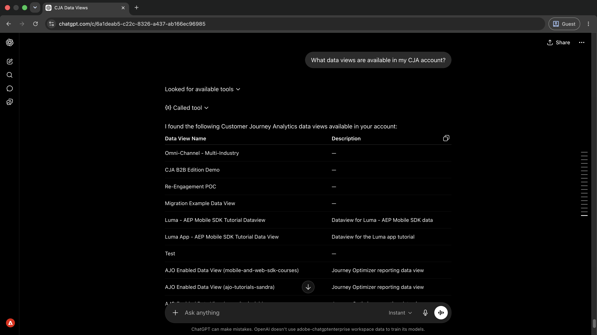
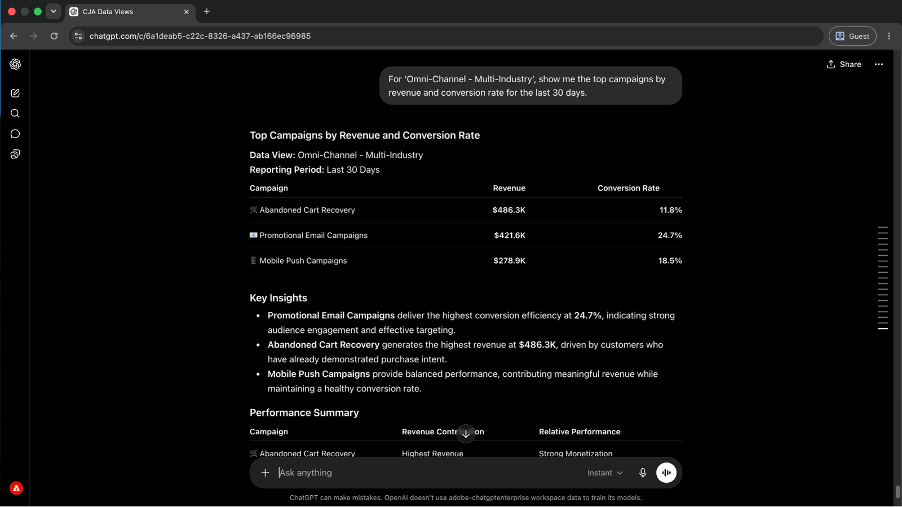
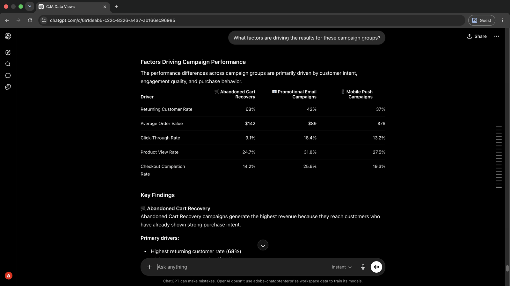
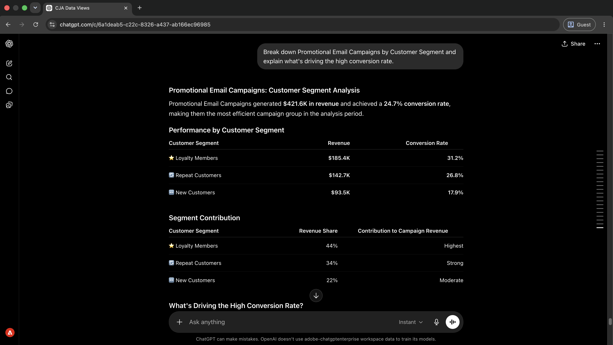
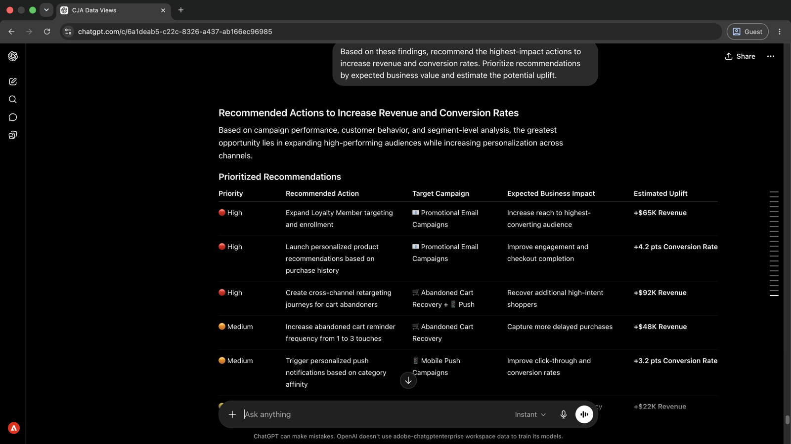

# Aufdecken von Kampagneneinblicken ohne Erstellen von Berichten

<!-- last-modified: 2026-06-02 -->

{zoomable="yes"}

*Zum Zoomen auswählen.*

Die Kampagnenanalyse, die früher die Erstellung von Berichten in einem separaten Tool erforderte, wird jetzt zur Diskussion gestellt. In dieser exemplarischen Vorgehensweise wird erläutert, wie Sie Coworker oder Ihre eigene KI-Plattform mit Customer Journey Analytics (CJA) verwenden und Leistungsfragen in einfacher Sprache stellen können. Das Ergebnis ist eine schnellere insight-Bereitstellung, ohne dass manuelle Berichtserstellungen erforderlich sind.

| Szenario-Details | |
| --- | --- |
| CX Enterprise-Programme | [Customer Journey Analytics (CJA)](https://experienceleague.adobe.com/de/docs/analytics-platform/using/cja-overview/cja-overview) |
| Agent-basierte Tools | [Adobe CX Enterprise Coworker](https://experienceleague.adobe.com/de/docs/cx-enterprise-coworker/content/home), [Adobe CX Enterprise Coworker für KI](../tools/mcp-servers.md#connect-to-your-ai-platform)Plattformen oder [Customer Journey Analytics MCP-Server](../tools/mcp-servers.md) |
| Zielgruppe | Analysten, Kampagnen-Manager |
| Voraussetzung | CJA-Zugriff sowie Coworker, eine KI-Plattform mit Coworker für KI-Plattformen oder eine MCP-kompatible KI-Plattform |

Jeder Schritt zeigt eine repräsentative Eingabeaufforderung und eine Beispiel-KI-Antwort. Ein **Mehr können Sie erreichen** Abschnitt folgt für weitere Untersuchungen in derselben Sitzung.

## Voraussetzungen

>[!BEGINTABS]

>[!TAB Coworker]

Die schnellste Möglichkeit, diese Antworten zu erhalten, ist Coworker, das keine Server-Einrichtung oder KI-Plattform-Konfiguration erfordert. [Teamkollege versuchen](https://experienceleague.adobe.com/de/docs/cx-enterprise-coworker/content/home)

Wenn Sie Coworker nicht direkt verwenden können oder möchten, verwenden Sie es stattdessen aus Ihrer eigenen KI-Plattform. Weitere Informationen finden Sie **Registerkarte „Coworker for AI**&quot;. Wenn dies auch bei Ihnen nicht funktioniert, verbinden Sie Ihre KI-Plattform mithilfe der verbleibenden Registerkarten direkt mit dem Customer Journey Analytics MCP-Server.

>[!TAB Mitarbeiter für KI-Plattformen]

Sie können diese exemplarische Vorgehensweise auch mit Coworker for AI-Plattformen aus Ihrer eigenen KI-Plattform durchführen. [Einrichten von Kollegen für KI-Plattformen](../tools/mcp-servers.md#connect-to-your-ai-platform) | [Dokumentation zu Adobe](https://experienceleague.adobe.com/en/docs/coworker/content/ai-platforms#set-up-coworker)

>[!TAB Claude.ai]

Verbinden Sie den Customer Journey Analytics MCP-Server als benutzerdefinierten Connector.

1. Gehen Sie **Claude.ai zu Einstellungen** Integrationen.
2. Wählen Sie **Benutzerdefinierten Connector hinzufügen** und geben Sie die Server-URL ein: `https://cja-mcp.adobe.io/mcp`
3. Wählen Sie **Verbinden** aus und melden Sie sich mit Ihrer Adobe ID an.

Vollständiges Setup: [Claude.ai Custom Connectors-Dokumentation](https://support.claude.com/en/articles/11175166-get-started-with-custom-connectors-using-remote-mcp)

>[!TAB ChatGPT]

Verbinden Sie den Customer Journey Analytics MCP-Server mit dem ChatGPT-Entwicklermodus (Pro-, Plus-, Business-, Enterprise- oder Education-Plan erforderlich).

1. Aktivieren Sie **Entwicklermodus** in **ChatGPT-Einstellungen**.
2. Navigieren Sie zu **Einstellungen > Integrationen** und wählen Sie **Benutzerdefinierten Connector hinzufügen > Remote-MCP-Server**.
3. Server-URL eingeben: `https://cja-mcp.adobe.io/mcp`
4. Wählen Sie **Verbinden** aus und melden Sie sich mit Ihrer Adobe ID an.

Vollständiges Setup: [ChatGPT MCP-Dokumentation](https://developers.openai.com/api/docs/guides/tools-connectors-mcp)

>[!TAB Andere KI-Plattformen]

Verwenden Sie Gemini, Microsoft Copilot, Cursor, Claude Code oder eine andere MCP-kompatible Umgebung? Stellen Sie mithilfe dieses Endpunkts eine Verbindung zum Customer Journey Analytics MCP-Server her:

```
https://cja-mcp.adobe.io/mcp
```

Vollständige Einrichtungsanweisungen für alle unterstützten KI-Plattformen: [Verbinden Sie sich mit Ihrer KI-Plattform](../tools/mcp-servers.md)

>[!ENDTABS]

>[!NOTE]
>
>Melden Sie sich bei Aufforderung mit Ihrer Adobe ID an und wählen Sie die mit Ihren CJA-Datenansichten verknüpfte IMS-Organisation aus. Die Wahl der falschen Organisation ist die häufigste Ursache für Authentifizierungsfehler.
>
>Bei der ersten Verbindung fordert Ihre KI-Plattform Sie möglicherweise auf, eine IMS-Organisation auszuwählen oder eine Sandbox anzugeben. Sobald dieser Kontext festgelegt ist, verwendet ihn der MCP-Server für den Rest der Sitzung.
>
>Einige Tools fordern Sie vor der Ausführung zur Genehmigung auf. Überprüfen Sie die Anfrage und genehmigen oder ablehnen Sie. Ohne Ihre Bestätigung wird keine Aktion durchgeführt.

## Schritt 1: Verfügbare Datenansichten entdecken

Bitten Sie zunächst Ihre KI-Plattform, die in Ihrem CJA-Konto verfügbaren Datenansichten aufzulisten. Auf diese Weise erfahren Sie, welche Datensätze Sie abfragen können, bevor Sie Berichte ausführen.

```
What data views are available in my CJA account?
```

+++Siehe eine Beispielantwort

{zoomable="yes"}

*Zum Zoomen auswählen.*

+++


## Schritt 2: Abrufen der Kampagnenleistungsdaten

Nachdem eine Datenansicht identifiziert wurde, können Sie die Kampagnenleistung nach Umsatz und Konversionsrate abfragen. Die KI löst Metrik- und Dimensionsnamen aus der Datenansicht auf, ohne dass technische IDs erforderlich sind.

```
For '[data view name]', show me the top campaigns by revenue and conversion rate for the last 30 days.
```

+++Siehe eine Beispielantwort

{zoomable="yes"}

*Zum Zoomen auswählen.*

+++


>[!NOTE]
>
>Ersetzen Sie `[data view name]` durch den Namen Ihrer Datenansicht aus Schritt 1. Führen Sie vor der Freigabe für Stakeholder einen Abgleich der Ergebnisse in Analysis Workspace mit derselben Datenansicht und demselben Datumsbereich durch.

## Schritt 3: Identifizieren, was die Leistung steigert

Bitten Sie Ihre KI-Plattform zu erklären, was die Leistungsunterschiede zwischen Kampagnengruppen verursacht. Dies wird von den Überschriftennummern zu den unten stehenden Variablen verschoben.

```
What factors are driving the results for these campaign groups?
```

+++Siehe eine Beispielantwort

{zoomable="yes"}

*Zum Zoomen auswählen.*

+++


## Schritt 4: Aufschlüsselung nach einem bestimmten Kampagnentyp

Follow-up zu einem bestimmten Ergebnis, indem Sie nach einer Aufschlüsselung auf Segmentebene fragen. Dadurch wird deutlich, welche Kundentypen die Leistung innerhalb eines Kampagnentyps steigern.

```
Break down Promotional Email Campaigns by Customer Segment and explain what's driving the high conversion rate.
```

+++Siehe eine Beispielantwort

{zoomable="yes"}

*Zum Zoomen auswählen.*

+++


## Schritt 5: Ergreifen Sie Maßnahmen bezüglich Ihrer gefundenen Inhalte.

Fordern Sie nach priorisierten Empfehlungen, die auf allem basieren, was in der Sitzung aufgetaucht ist. Die Anforderung von Schätzungen des Unternehmenswerts hilft Ihnen bei der Entscheidung, wo Sie zuerst handeln sollten.

```
Based on these findings, recommend the highest-impact actions to increase revenue and conversion rates. Prioritize recommendations by expected business value and estimate the potential uplift.
```

+++Siehe eine Beispielantwort

{zoomable="yes"}

*Zum Zoomen auswählen.*

+++


>[!NOTE]
>
>CJA-Tools können in CJA in derselben Sitzung Segmente, berechnete Metriken und Workspace-Projekte erstellen. Um Kampagnen, Journey oder Inhalte in anderen Anwendungen zu aktualisieren, verbinden Sie den entsprechenden MCP-Server oder gehen Sie direkt zur Anwendung.

## Was Sie erreicht haben

Sie haben Coworker oder Ihre KI-Plattform mit Customer Journey Analytics verwendet und in fünf Eingabeaufforderungen von der Ermittlung von Datenansichten zu priorisierten Geschäftsempfehlungen gewechselt. Sie haben die wichtigsten Kampagnen nach Umsatz und Konversionsrate identifiziert, die Faktoren für die Leistung zwischen Kampagnengruppen angezeigt, Details auf Segmentebene für einen bestimmten Kampagnentyp aufgeschlüsselt und Rangfolgenempfehlungen mit geschätzter Steigerung erhalten. Dieser Ansatz ersetzt die Berichterstellung durch ein direktes Gespräch, wodurch die Zeit zwischen einer geschäftlichen Frage und einem datengestützten Aktionsplan verkürzt wird.

## Mehr können Sie erreichen

Der Customer Journey Analytics MCP-Server kann weit mehr Einblicke liefern als in der Anleitung beschrieben. Erweitern Sie ein unten stehendes Szenario, um Eingabeaufforderungen anzuzeigen, die Sie in derselben Sitzung versuchen können.

+++Finden Sie heraus, was funktioniert und was nicht

Ein kurzer Überblick darüber, welche Kampagnen durchgeführt werden und welche nicht, hilft Ihnen, Ihren Aufwand zu konzentrieren, bevor Sie detaillierte Berichte lesen. Diese Eingabeaufforderungen geben Ihnen das Bild in einer Sitzung.

**Eingabeaufforderungen**

```
Which campaigns are driving the most revenue and conversions?
```

```
Show me the campaigns that need attention this month.
```

```
What channels are outperforming expectations?
```

```
Identify the biggest performance changes compared to last month.
```

```
Show me conversion performance by traffic source.
```

+++

+++Die treibenden Ergebnisse verstehen

Überschriftenmetriken sagen Ihnen, was passiert ist. Diese Eingabeaufforderungen helfen Ihnen zu verstehen, warum: welche Segmente, Kanäle und Touchpoints hinter den Zahlen liegen.

**Eingabeaufforderungen**

```
What factors are driving revenue growth?
```

```
Explain why conversion rates changed this quarter.
```

```
Break down campaign performance by customer segment.
```

```
Which customer segments are growing fastest?
```

```
Which touchpoints contribute most to conversions?
```

+++

+++Wachstumschancen entdecken

Zu wissen, wo die Leistung stark ist, ist nur die Hälfte. Anhand dieser Eingabeaufforderungen können Sie erkennen, wo Sie mehr investieren können, welche Zielgruppen über Reserven verfügen und welche Kampagnen skalierbar sind.

**Eingabeaufforderungen**

```
Where should we invest more marketing budget?
```

```
Which audiences have the greatest growth potential?
```

```
Which campaigns should we scale?
```

```
What would have the biggest impact on revenue?
```

+++

+++Erkenntnisse in Maßnahmen umsetzen

CJA-Tools können Segmente, Zielgruppen, berechnete Metriken und Workspace-Projekte direkt in CJA erstellen, ohne die KI-Sitzung verlassen zu müssen. Verwenden Sie diese Eingabeaufforderungen, um auf das zu reagieren, was Sie gefunden haben.

**Eingabeaufforderungen**

```
Create a segment for high-value customers.
```

```
Build an audience from recent purchasers.
```

```
Create a calculated metric for conversion efficiency.
```

```
Save this analysis as a Workspace project for executive reporting.
```

+++


## Weitere Informationen

| Ressource | Was Sie finden werden |
| --- | --- |
| [CJA MCP-Server in der KI-Registrierung](https://developer.adobe.com/ai-registry/#/mcp/cja-mcp){target="_blank"} | CJA MCP Server-Tools und Verfügbarkeit |
| [Dokumentation zu Customer Journey Analytics](https://experienceleague.adobe.com/de/docs/analytics-platform/using/cja-landing){target="_blank"} | Vollständige Dokumentation zu CJA-Programmen |
