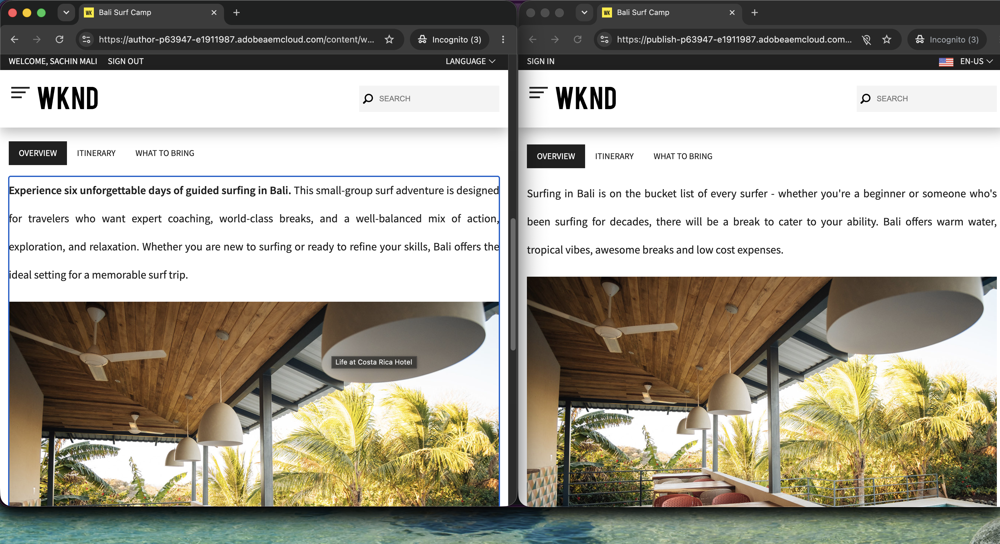
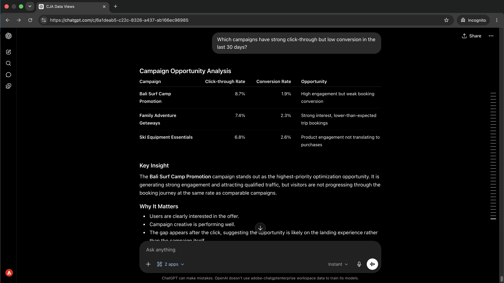
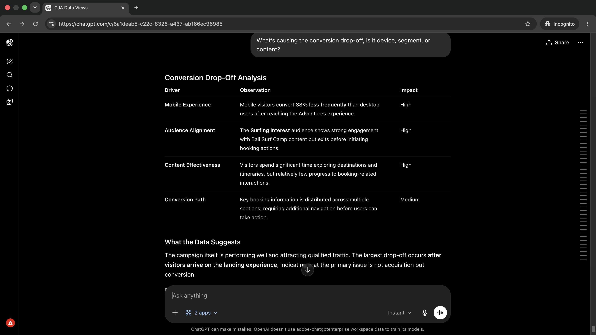
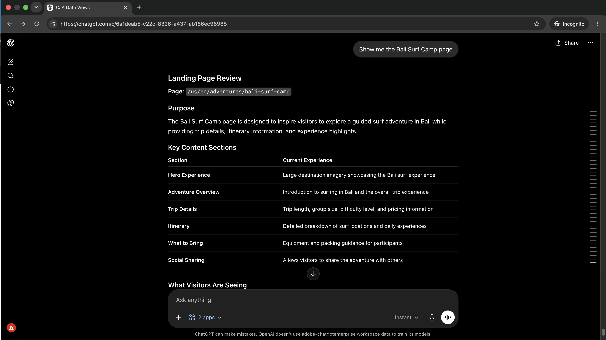
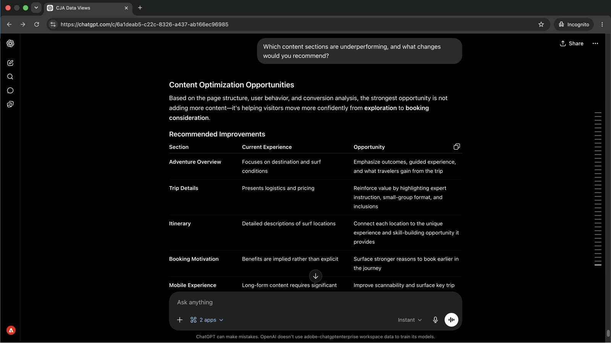
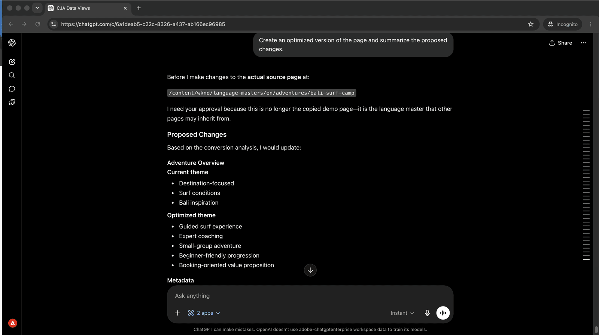

# Schließen Sie Lücken bei der Content-Performance mit datengesteuerten Aktualisierungen
<!-- last-modified: 2026-06-10 -->

{zoomable="yes"}

*Zum Zoomen auswählen.*

Unterschiede in der Content-Performance kosten Kampagnenergebnisse. Um diese zu schließen, muss normalerweise zwischen dem Analytics-Tool und Ihrer CMS gewechselt werden. In dieser exemplarischen Vorgehensweise wird gezeigt, wie dies in einer einzigen KI-Sitzung durchgeführt werden kann: Aufdecken von Kampagnen mit Konversionslücken in Customer Journey Analytics, Diagnostizieren der Ursache, Untersuchen der leistungsschwachen Inhalte in AEM und Anwenden von Aktualisierungen, ohne das Gespräch zu verlassen.

| Szenario-Details | |
| --- | --- |
| CX Enterprise-Programme | [Customer Journey Analytics](https://experienceleague.adobe.com/de/docs/analytics-platform/using/cja-overview/cja-overview), [Adobe Experience Manager as a Cloud Service](https://experienceleague.adobe.com/de/docs/experience-manager-cloud-service/content/overview/introduction) |
| Agent-basierte Tools | [Adobe CX Enterprise Coworker](https://experienceleague.adobe.com/de/docs/cx-enterprise-coworker/content/home), [Adobe CX Enterprise Coworker für KI-Plattformen](../tools/mcp-servers.md#connect-to-your-ai-platform) oder [Customer Journey Analytics MCP Server](../tools/mcp-servers.md) und [AEM MCP Server](https://experienceleague.adobe.com/de/docs/experience-manager-learn/cloud-service/ai/mcp-servers/overview) |
| Zielgruppe | Kampagnen-Manager, Inhaltsstrategen, Marketing-Abläufe |
| Voraussetzung | CJA-Zugriff, AEM as a Cloud Service-Zugriff plus Coworker, eine KI-Plattform mit Coworker für KI-Plattformen oder eine MCP-kompatible KI-Plattform |

Jeder Schritt zeigt eine repräsentative Eingabeaufforderung und eine Beispiel-KI-Antwort. Ein **Mehr können Sie erreichen** Abschnitt folgt für weitere Untersuchungen in derselben Sitzung.


## Voraussetzungen

>[!BEGINTABS]

>[!TAB Coworker]

Ein Kollege behandelt die gesamte exemplarische Vorgehensweise, ohne dass eine Server-Einrichtung erforderlich ist. [Teamkollege versuchen](https://experienceleague.adobe.com/de/docs/cx-enterprise-coworker/content/home)

Wenn Sie Coworker nicht direkt verwenden können oder möchten, verwenden Sie es stattdessen aus Ihrer eigenen KI-Plattform. Weitere Informationen finden Sie **Registerkarte „Coworker for AI**&quot;. Wenn dies auch bei Ihnen nicht funktioniert, verbinden Sie Ihre KI-Plattform mithilfe der verbleibenden Registerkarten direkt mit den Customer Journey Analytics- und AEM MCP-Servern.

>[!TAB Mitarbeiter für KI-Plattformen]

Sie können diese exemplarische Vorgehensweise auch mit Coworker for AI-Plattformen aus Ihrer eigenen KI-Plattform durchführen. [Einrichten von Kollegen für KI-Plattformen](../tools/mcp-servers.md#connect-to-your-ai-platform) | [Dokumentation zu Adobe](https://experienceleague.adobe.com/de/docs/coworker/content/ai-platforms#set-up-coworker)

>[!TAB Claude.ai]

Schließen Sie beide MCP-Server als benutzerdefinierte Connectoren an. Jede einzeln hinzufügen.

1. Gehen Sie **Claude.ai zu Einstellungen** Integrationen.
2. Wählen Sie **Benutzerdefinierten Connector hinzufügen**, geben Sie eine Server-URL ein und klicken Sie auf **Verbinden**.
3. Melden Sie sich mit Ihrer Adobe ID an und wiederholen Sie den Vorgang für den zweiten Server.

| Server | Endpunkt |
| --- | --- |
| Customer Journey Analytics MCP-Server | `https://cja-mcp.adobe.io/mcp` |
| AEM MCP-Server | `https://mcp.adobeaemcloud.com/adobe/mcp/aem` |

Vollständiges Setup: [Claude.ai Custom Connectors-Dokumentation](https://support.claude.com/en/articles/11175166-get-started-with-custom-connectors-using-remote-mcp)

>[!TAB ChatGPT]

Verbinden Sie beide MCP-Server über den ChatGPT-Entwicklermodus (Pro-, Plus-, Business-, Enterprise- oder Education-Plan erforderlich). Jeden Server separat hinzufügen.

1. Aktivieren Sie **Entwicklermodus** in **ChatGPT-Einstellungen**.
2. Navigieren Sie zu **Einstellungen > Integrationen** und wählen Sie **Benutzerdefinierten Connector hinzufügen > Remote-MCP-Server**.
3. Geben Sie eine Server-URL ein **wählen Sie &quot;**&quot; aus und melden Sie sich mit Ihrer Adobe ID an.
4. Wiederholen Sie diesen Vorgang für den zweiten Server.

| Server | Endpunkt |
| --- | --- |
| Customer Journey Analytics MCP-Server | `https://cja-mcp.adobe.io/mcp` |
| AEM MCP-Server | `https://mcp.adobeaemcloud.com/adobe/mcp/aem` |

Vollständiges Setup: [ChatGPT MCP-Dokumentation](https://developers.openai.com/api/docs/guides/tools-connectors-mcp)

>[!TAB Andere KI-Plattformen]

Verwenden Sie Gemini, Microsoft Copilot, Cursor, Claude Code oder eine andere MCP-kompatible Umgebung? Verbinden Sie sich mit beiden MCP-Servern mithilfe der folgenden Endpunkte:

| Server | Endpunkt |
| --- | --- |
| Customer Journey Analytics MCP-Server | `https://cja-mcp.adobe.io/mcp` |
| AEM MCP-Server | `https://mcp.adobeaemcloud.com/adobe/mcp/aem` |

Vollständige Einrichtungsanweisungen für alle unterstützten KI-Plattformen: [Verbinden Sie sich mit Ihrer KI-Plattform](../tools/mcp-servers.md)

>[!ENDTABS]

>[!NOTE]
>
>Melden Sie sich bei Aufforderung mit Ihrer Adobe ID an und wählen Sie die mit Ihrer CJA- und AEM-Umgebung verknüpfte IMS-Organisation aus. Die Wahl der falschen Organisation ist die häufigste Ursache für Authentifizierungsfehler.
>
>Bei der ersten Verbindung fordert Ihre KI-Plattform Sie möglicherweise auf, eine IMS-Organisation auszuwählen oder eine Sandbox anzugeben. Sobald dieser Kontext festgelegt ist, verwendet ihn der MCP-Server für den Rest der Sitzung.
>
>Einige Tools fordern Sie vor der Ausführung zur Genehmigung auf. Überprüfen Sie die Anfrage und genehmigen oder ablehnen Sie. Ohne Ihre Bestätigung wird keine Aktion durchgeführt.


## Schritt 1: Suchen von Kampagnen mit einer Konversionslücke

Verwenden Sie CJA, um Kampagnen aufzudecken, bei denen der Clickthrough hoch, die Konversionsrate jedoch niedrig ist. Dieses Muster (hoher Intent, geringer Abschluss) verweist in der Regel auf ein Inhalts- oder Erlebnisproblem auf der Landingpage.

```
Which campaigns have strong click-through but low conversion in the last 30 days?
```

+++Siehe eine Beispielantwort

{zoomable="yes"}

*Zum Zoomen auswählen.*

+++


## Schritt 2: Diagnose der Grundursache

Folgen Sie, um zu verstehen, was die Lücke verursacht. Fragen Sie, ob sich der Abbruch auf einen bestimmten Gerätetyp, ein bestimmtes Zielgruppensegment oder eine bestimmte Inhaltsinteraktion konzentriert.

```
What's causing the conversion drop-off, is it device, segment, or content?
```

+++Siehe eine Beispielantwort

{zoomable="yes"}

*Zum Zoomen auswählen.*

+++


## Schritt 3: Inhalt in AEM überprüfen

Ziehen Sie bei identifizierter schwacher Kampagne in derselben Sitzung die Landingpage aus AEM. Wenn Sie sehen, was auf der Seite derzeit steht, können Sie verstehen, was geändert werden muss.

```
Show me the Bali Surf Camp page.
```

+++Siehe eine Beispielantwort

{zoomable="yes"}

*Zum Zoomen auswählen.*

+++


## Schritt 4: Abrufen zielgerichteter Empfehlungen

Bitten Sie Ihre KI-Plattform, die angezeigten Daten mit dem zu verbinden, was sich auf der Seite befindet. Die KI-Gründe für beide Quellen identifizieren, welche Inhaltsabschnitte wahrscheinlich den Abbruch verursachen und was sich ändern sollte.

```
Which content sections are underperforming, and what changes would you recommend?
```

+++Siehe eine Beispielantwort

{zoomable="yes"}

*Zum Zoomen auswählen.*

+++


## Schritt 5: Änderungen anwenden und überprüfen

Bitten Sie Ihre KI-Plattform, eine optimierte Version der Seite auf der Grundlage der Empfehlungen zu erstellen, und fassen Sie zusammen, was sich geändert hat und warum.

```
Create an optimized version of the Bali Surf Camp page and summarize the proposed changes.
```

+++Siehe eine Beispielantwort

{zoomable="yes"}

*Zum Zoomen auswählen.*

+++


>[!CAUTION]
>
>Überprüfen Sie die vollständige Zusammenfassung der vorgeschlagenen Änderungen, bevor Sie sie bestätigen. Der AEM MCP-Server schreibt Änderungen in Ihre AEM-Umgebung. Die Seiten verbleiben in ihrem veröffentlichten Status, bis Sie sie erneut veröffentlichen.


## Was Sie erreicht haben

Sie haben Customer Journey Analytics und AEM in einer einzigen KI-Sitzung verbunden und von Kampagnendaten zu bereitgestellten Inhaltsänderungen verschoben, ohne die Tools zu wechseln. Sie haben Kampagnen mit Konversionslücken identifiziert, die Grundursache diagnostiziert, die Landingpage geprüft, zielgerichtete Empfehlungen erhalten, die sowohl auf Daten als auch auf Inhalten basieren, und die Änderungen in derselben Konversation angewendet. Dadurch wird die Feedback-Schleife zwischen Analytics insight und veröffentlichten Inhalten verkürzt und auf eine beliebige Anzahl leistungsschwacher Seiten in derselben Sitzung skaliert.


## Mehr können Sie erreichen

Wenn CJA und AEM in derselben Sitzung verbunden sind, können Sie den gesamten Zyklus von der Identifizierung von Problemen bis hin zu Versandkorrekturen abdecken. Erweitern Sie ein unten stehendes Szenario, um Eingabeaufforderungen anzuzeigen, die Sie ausprobieren können.

+++Suchen nach Inhalten, die die Leistung beeinträchtigen

Hoher Traffic mit geringer Interaktion signalisiert ein Inhaltsproblem, kein Verkehrsproblem. Mithilfe dieser Eingabeaufforderungen können bestimmte Seiten und Muster angezeigt werden, die bearbeitet werden müssen, bevor eine Kampagnentermine das Problem erzwingt.

**Eingabeaufforderungen**

```
Which campaigns have the highest traffic but lowest conversion rate this quarter?
```

```
Which pages have a high bounce rate but also high traffic?
```

```
Compare engagement rates for landing pages across email and paid social campaigns.
```

```
Find AEM pages linked from active campaigns that haven't been updated in over 60 days.
```

+++

+++Korrigieren, was die Daten von Ihnen verlangen

Sobald Sie wissen, was hinter den Erwartungen zurückbleibt, sollten Sie zielgerichtete Änderungen vornehmen, die auf den Leistungsdaten basieren. Mit diesen Eingabeaufforderungen können Sie bestimmte Abschnitte basierend auf der Diagnose aktualisieren.

**Eingabeaufforderungen**

```
Update the CTA on the [page name] page to better match the campaign audience.
```

```
Rewrite the hero headline on the [page name] page to address the mobile drop-off.
```

```
Add a trust signal to the [page name] page above the conversion form.
```

```
Which pages updated in this session still need to be published?
```

+++

+++Versandverbesserungen vor der nächsten Kampagne

Änderungen, die während der Sitzung vorgenommen wurden, können sich schnell stapeln. Mit diesen Eingabeaufforderungen können Sie überprüfen, was bereit ist, Aktualisierungen zur Überprüfung gruppieren und sauber weiterleiten, bevor eine Kampagne live geschaltet wird.

**Eingabeaufforderungen**

```
Show me all pages updated in this session that are still unpublished.
```

```
Create a launch with all changes from this session for review before publishing.
```

```
Give me a summary of all changes made in this session.
```

```
Publish all confirmed changes and share the updated URLs.
```

+++


## Weitere Informationen

| Ressource | Was Sie finden werden |
| --- | --- |
| [CJA MCP-Server in der KI-Registrierung](https://developer.adobe.com/ai-registry/#/mcp/cja-mcp){target="_blank"} | CJA MCP Server-Tools und Verfügbarkeit |
| [Dokumentation zum AEM MCP-Server](https://experienceleague.adobe.com/de/docs/experience-manager-learn/cloud-service/ai/mcp-servers/overview){target="_blank"} | AEM MCP Server-Tools und Verfügbarkeit |
