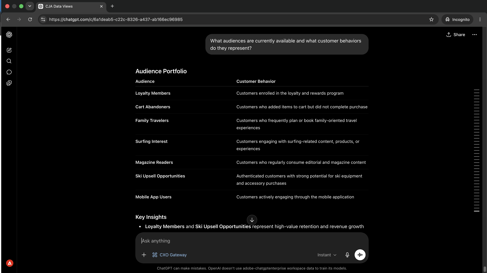
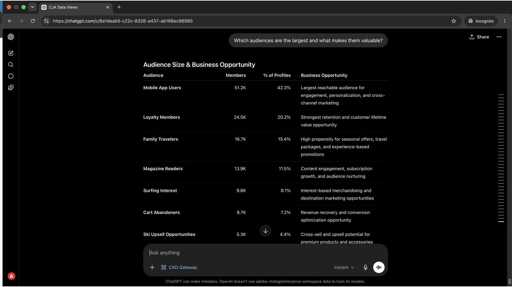
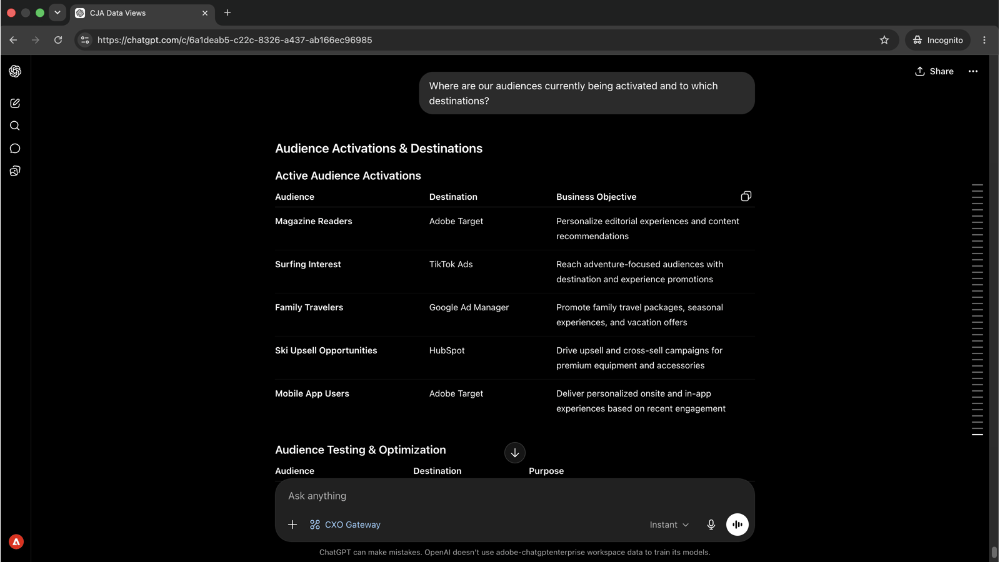
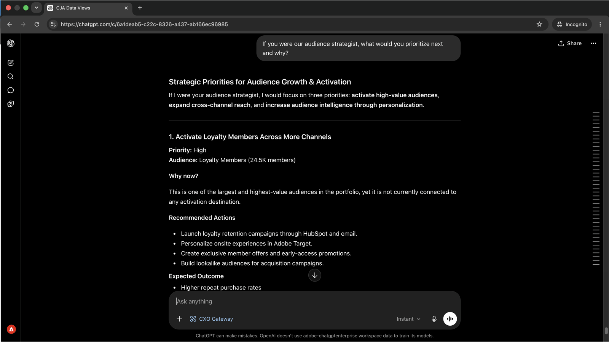

# Zielgruppen verstehen und wo sie aktiviert werden

<!-- last-modified: 2026-06-04 -->

{zoomable="yes"}

*Zum Zoomen auswählen.*

Zu wissen, welche Zielgruppen live sind, wohin sie fließen und ob die Ziele in Ordnung sind, ist entscheidend, bevor eine Kampagne gestartet wird oder wenn eine Kampagne nicht die gewünschte Leistung erbringt. In dieser exemplarischen Vorgehensweise wird gezeigt, wie Sie mithilfe des Real-Time CDP MCP-Servers ein vollständiges Aktivierungsbild über eine KI-Plattform erhalten, um den Zielgruppenstatus und den Zielzustand in Sekunden anzuzeigen, ohne Real-Time CDP zu öffnen.

>[!NOTE]
>
>Der Real-Time CDP MCP-Server befindet sich in der öffentlichen Betaversion und erfordert, dass Ihr Unternehmen für den Zugriff auf die Zulassungsliste gesetzt ist.

| Szenario-Details | |
| --- | --- |
| CX Enterprise-Programme | [Real-Time Customer Data Platform (Real-Time CDP)](https://experienceleague.adobe.com/de/docs/experience-platform/rtcdp/home) |
| Agent-basierte Tools | [Adobe CX Enterprise Coworker](https://experienceleague.adobe.com/de/docs/cx-enterprise-coworker/content/home), [Adobe CX Enterprise Coworker für KI](../tools/mcp-servers.md#connect-to-your-ai-platform)Plattformen oder [Real-Time CDP MCP-Server](../tools/mcp-servers.md) |
| Zielgruppe | Marketing-Experten, Analysten, Benutzer |
| Voraussetzung | Real-Time CDP-Zugriff sowie Coworker, eine KI-Plattform mit Coworker für KI-Plattformen oder eine MCP-kompatible KI-Plattform |

Jeder Schritt zeigt eine repräsentative Eingabeaufforderung und eine Beispiel-KI-Antwort. Ein **Mehr können Sie erreichen** Abschnitt folgt für weitere Untersuchungen in derselben Sitzung.

## Voraussetzungen

>[!BEGINTABS]

>[!TAB Coworker]

Die schnellste Möglichkeit, dieses Aktivierungsbild zu erhalten, ist Coworker, das keine Server-Einrichtung oder KI-Plattform-Konfiguration erfordert. [Teamkollege versuchen](https://experienceleague.adobe.com/de/docs/cx-enterprise-coworker/content/home)

Wenn Sie Coworker nicht direkt verwenden können oder möchten, verwenden Sie es stattdessen aus Ihrer eigenen KI-Plattform. Weitere Informationen finden Sie **Registerkarte „Coworker for AI**&quot;. Wenn dies auch bei Ihnen nicht funktioniert, verbinden Sie Ihre KI-Plattform mithilfe der verbleibenden Registerkarten direkt mit dem Real-Time CDP MCP-Server. Der Real-Time CDP-MCP-Server befindet sich in der öffentlichen Betaversion und erfordert die auf die Zulassungsliste setzte Ihres Unternehmens.

>[!TAB Mitarbeiter für KI-Plattformen]

Sie können diese exemplarische Vorgehensweise auch mit Coworker for AI-Plattformen aus Ihrer eigenen KI-Plattform durchführen. [Einrichten von Kollegen für KI-Plattformen](../tools/mcp-servers.md#connect-to-your-ai-platform) | [Dokumentation zu Adobe](https://experienceleague.adobe.com/de/docs/coworker/content/ai-platforms#set-up-coworker)

>[!TAB Claude.ai]

Verbinden Sie den Real-Time CDP MCP-Server als benutzerdefinierten Connector.

1. Gehen Sie **Claude.ai zu Einstellungen** Integrationen.
2. Wählen Sie **Benutzerdefinierten Connector hinzufügen** und geben Sie die Server-URL ein: `https://rtcdp-mcp.adobe.io/mcp`
3. Wählen Sie **Verbinden** aus und melden Sie sich mit Ihrer Adobe ID an.

Vollständiges Setup: [Claude.ai Custom Connectors-Dokumentation](https://support.claude.com/en/articles/11175166-get-started-with-custom-connectors-using-remote-mcp)

>[!TAB ChatGPT]

Verbinden Sie den Real-Time CDP MCP-Server mit dem ChatGPT-Entwicklermodus (Pro-, Plus-, Business-, Enterprise- oder Education-Plan erforderlich).

1. Aktivieren Sie **Entwicklermodus** in **ChatGPT-Einstellungen**.
2. Navigieren Sie zu **Einstellungen > Integrationen** und wählen Sie **Benutzerdefinierten Connector hinzufügen > Remote-MCP-Server**.
3. Server-URL eingeben: `https://rtcdp-mcp.adobe.io/mcp`
4. Wählen Sie **Verbinden** aus und melden Sie sich mit Ihrer Adobe ID an.

Vollständiges Setup: [ChatGPT MCP-Dokumentation](https://developers.openai.com/api/docs/guides/tools-connectors-mcp)

>[!TAB Andere KI-Plattformen]

Verwenden Sie Gemini, Microsoft Copilot, Cursor, Claude Code oder eine andere MCP-kompatible Umgebung? Stellen Sie mithilfe dieses Endpunkts eine Verbindung zum Real-Time CDP MCP-Server her:

```
https://rtcdp-mcp.adobe.io/mcp
```

Vollständige Einrichtungsanweisungen für alle unterstützten KI-Plattformen: [Verbinden Sie sich mit Ihrer KI-Plattform](../tools/mcp-servers.md)

>[!ENDTABS]

>[!NOTE]
>
>Melden Sie sich bei Aufforderung mit Ihrer Adobe ID an und wählen Sie die mit Ihrer Real-Time CDP-Instanz verknüpfte IMS-Organisation aus. Die Wahl der falschen Organisation ist die häufigste Ursache für Authentifizierungsfehler.

## Schritt 1: Entdecken Sie Ihre Audiences und ihre Bedeutung

Fragen Sie zunächst nach einer Aufstellung der verfügbaren Zielgruppen und der von ihnen erfassten Kundenverhaltensweisen. Dadurch erhalten Sie die vollständige Landschaft, bevor Sie in ein bestimmtes Segment bohren.

```
What audiences are currently available and what customer behaviors do they represent?
```

+++Siehe eine Beispielantwort

{zoomable="yes"}

*Zum Zoomen auswählen.*

+++


## Schritt 2: Identifizieren Sie Ihre wertvollsten Segmente

Fragen Sie sich angesichts der Zielgruppenlandschaft, welche Segmente am größten sind und was sie strategisch wertvoll macht.

```
Which audiences are the largest and what makes them valuable?
```

+++Siehe eine Beispielantwort

{zoomable="yes"}

*Zum Zoomen auswählen.*

+++


## Schritt 3: Überprüfen Sie Aktivierung und Ziele

Fragen Sie, wohin Ihre Zielgruppen derzeit fließen und für welche Ziele sie aktiviert sind.

```
Where are our audiences currently being activated and to which destinations?
```

+++Siehe eine Beispielantwort

{zoomable="yes"}

*Zum Zoomen auswählen.*

+++


## Schritt 4: Abrufen strategischer Empfehlungen

Die Tools des Real-Time CDP MCP-Servers sind schreibgeschützt, d. h. sie ermöglichen den Aktivierungsstatus, den Zielzustand und die Datenflussdaten, ändern jedoch nicht die Konfiguration. Nachdem Sie ein Problem identifiziert haben, erfolgt die Fehlerbehebung in der Anwendung.

```
If you were our audience strategist, what would you prioritize next and why?
```

+++Siehe eine Beispielantwort

{zoomable="yes"}

*Zum Zoomen auswählen.*

+++


>[!NOTE]
>
>Die Tools des Real-Time CDP-MCP-Servers überdecken Ziel- und Aktivierungsdaten, können jedoch keine Zielkonfiguration, Segmentdefinitionen oder Datenflusseinstellungen ändern. In der Real-Time CDP-Anwendung werden Behebungsschritte ausgeführt.

## Was Sie erreicht haben

Sie haben Coworker oder Ihre KI-Plattform mit Real-Time CDP verwendet und an vier Eingabeaufforderungen ein strategisches Bild Ihres Zielgruppenportfolios erstellt. Sie haben die verfügbaren Zielgruppen den Kundenverhaltensweisen zugeordnet, die sie erfasst haben, Ihre größten und wertvollsten Segmente identifiziert, bestätigt, wo jede Zielgruppe hinfließt und zu welchen Zielen sie wechselt, und bei Ihrer nächsten Aktivierung priorisierte Empfehlungen erhalten. Dadurch wird die Navigation auf mehreren Real-Time CDP-Bildschirmen durch eine direkte, strategische Konversation ersetzt.

## Mehr können Sie erreichen

Der Real-Time CDP MCP-Server unterstützt eine breite Palette von Zielgruppen- und Aktivierungsabfragen. Erweitern Sie ein unten stehendes Szenario, um Eingabeaufforderungen anzuzeigen, die Sie in derselben Sitzung versuchen können.

+++Vor dem Versand einer Kampagne genau wissen, was wo fließt

Aktivierungsfehler sind unauffällig. Zielgruppen können ohne Warnung nicht mehr weitergeleitet werden und senden Kampagnen an veraltete Listen. Diese Eingabeaufforderungen geben Ihnen ein klares Bild darüber, welche Segmente welche Ziele wann erreichen.

**Eingabeaufforderungen**

```
Which audiences are activated to Google Ads?
```

```
Show me the activation history for the [audience name] audience.
```

```
What is the last refresh time for the [audience name] audience?
```

+++

+++Aktivierungsprobleme erkennen, bevor sie eine Kampagne betreffen

Ein Ziel, das einen Lauf verpasst hat, oder ein Segment ohne aktives Ziel, bedeutet, dass Ihre Kampagne möglicherweise weniger Personen erreicht als beabsichtigt. Diese Eingabeaufforderungen decken diese Lücken proaktiv auf.

**Eingabeaufforderungen**

```
Are there any audiences with no active destinations?
```

```
Are any destination dataflows showing errors right now?
```

```
Which audiences have not been updated in the last 30 days?
```

+++

+++Auditieren und Verstehen der Zielgruppenlandschaft

Wenn sich die Zielgruppengröße ändert oder neue Segmente erstellt werden, hilft Ihnen ein klarer Bestand bei der Planung und Vermeidung der Aktivierung der falschen Liste. Diese Eingabeaufforderungen geben Ihnen diese Sichtbarkeit auf Anfrage.

**Eingabeaufforderungen**

```
How many profiles are in the [segment name] segment?
```

```
Show me all audiences created in the last 30 days.
```

```
Which audience has grown the most in the last 60 days?
```

```
How many total profiles are in my Real-Time CDP instance?
```

+++

+++Identitäten und Datenqualität verstehen

Identitäts-Namespaces und Zusammenführungsrichtlinien wirken sich direkt darauf aus, welche Profile in einer Zielgruppe enthalten sind und wie sie aufgelöst werden. Dies zeigt Details zur Oberflächenkonfiguration an, die unerwartete Zielgruppengrößen oder Profilüberschneidungen erklären können.

**Eingabeaufforderungen**

```
What identity namespaces are configured and which are most commonly used?
```

```
What merge policies are defined and which audiences use each one?
```

```
Are there any audiences using a non-default merge policy that could cause profile overlap?
```

+++


## Weitere Informationen

| Ressource | Was Sie finden werden |
| --- | --- |
| [Adobe AI-Registrierung](https://developer.adobe.com/ai-registry/?type=mcp){target="_blank"} | Verwaltete Connectoren und Serverdetails für ausgewählte Adobe MCP-Server |
| [Dokumentation zu Real-Time CDP](https://experienceleague.adobe.com/de/docs/experience-platform/rtcdp/home){target="_blank"} | Vollständige Dokumentation zu Real-Time CDP-Programmen |
